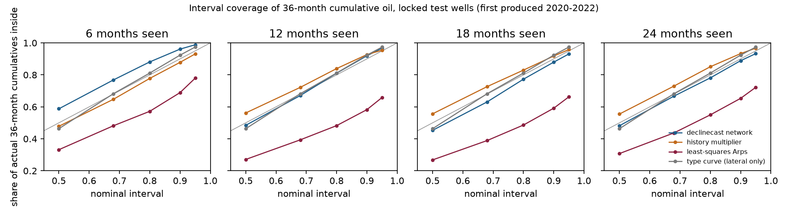

# declinecast

declinecast forecasts how much oil a young horizontal well will have produced by month 36 (or
60) from its first 6 to 24 months of production, and gives each forecast a range that holds up:
on wells it never saw, its 80% range (P90 to P10) contains the outcome close to 80% of the
time. It does this with amortized Bayesian inference: a neural network trained on 500,000
simulated wells returns, for any well in a fraction of a second, a posterior over the
parameters of the industry's own decline model (modified hyperbolic Arps), with the noise and
downtime of real monthly records inferred per well. The posterior's calibration is checked on
simulated wells, where the truth is known (simulation-based calibration and coverage), and the
forecasts are scored on real Colorado wells against what analysts already use. The data layer
(the panel build from 9.4 million raw regulator rows, the quality checks and the Tableau
tables) is DuckDB SQL, tested against an independent pandas version.

The package ships a derived extract of 8,344 DJ Basin horizontal Niobrara and Codell wells
from the Colorado Energy & Carbon Management Commission (ECMC) and a pretrained model.

**Dashboard:** the results on the locked test wells are on
[Tableau Public](https://public.tableau.com/app/profile/nathan.steinle/viz/declinecast36-monthcumulativeoilforecastswithrangesforDJBasinwells/declinecast),
built from the tables that `declinecast tableau` writes.

**The business question:** an acquisitions team, a royalty buyer or a reserve-based lender
looks at a well that has produced for a year. How much oil will it have produced in three
years, what are the low and high cases, and can those cases be trusted?

## Results on the locked test (1,463 wells first produced 2020-2022)

The test wells were set aside on 7 November 2026, before any scoring, and scored once.
Forecasts are of cumulative oil from first production to month 36. Ranges in brackets are 95%
bootstrap intervals that resample whole operators (20 to 22 operators), because wells of one
operator are not independent.

| Question | Answer |
|---|---|
| Do the ranges hold up? | **Yes.** The 80% range contains the actual 36-month oil for 88% of wells seen for 6 months, 81% at 12 months, 77% at 18 and 78% at 24; the 90% range for 96%, 92%, 88% and 89%. The 18- and 24-month figures are 2 to 3 points under nominal, and their intervals ([74%, 82%] and [74%, 83%]) contain 80%. |
| Better than least-squares Arps, the analyst's default? | **Yes, mainly on the ranges.** A per-well least-squares fit's 80% range contains the outcome for only 48% to 57% of wells. The network's weighted interval score (WIS, a proper score for ranges; lower is better) is lower at every history, and its median is more accurate at 6 months (−0.020 [−0.027, −0.007] dex) and ties from 12 months on. |
| Better than the simplest empirical method? | **Only with two years of history.** Multiplying a well's oil to date by how similar wells went is a strong benchmark. The two tie on WIS at 6, 12 and 18 months; the network is better at 24 months (−0.0015 [−0.0033, −0.0000]). The multiplier's median is more accurate at 12 months (6.0% against 6.8% median error), and its ranges are better calibrated at 18 to 24 months. |
| Is it faster than per-well MCMC, without losing accuracy? | **Yes, modestly.** Per-well MCMC on the same model and the same wells (the published Bayesian approach) ties the network at 12 and 18 months and is 0.2% more accurate at 24, while the network's ranges are better calibrated there (78% against 75%). The network needs 0.16 s per forecast against 0.40 s for MCMC vectorized over wells and 1.41 s one well at a time, so its 1.85-hour training pays back after about 5,300 to 28,200 forecasts. See FINDINGS section 12. |
| How accurate is the middle forecast? | The median error is 13% at 6 months, 6.8% at 12, 3.2% at 18 and 1.4% at 24 (part of the 36 months is already produced, so the error shrinks fast). |
| Is the forecast biased? | It was, at short histories: +22% at 6 months on test wells before a correction fit on development wells, and +6% after it. From 12 months on it is under 2% either way. The correction is applied by default and both versions are reported. |
| Which wells should not be trusted? | Wells flagged as unlike the training wells (lateral, rates, or a posterior pushing on its limits): 174 of 1,463. At 12 months their 80% range covers 68%, against 83% for the rest. |
| Is the uncertainty right on simulated wells? | Mostly. 173 of 180 coverage checks match their nominal level. Five of six parameters pass simulation-based calibration; the noise memory fails, and so do the derived cumulatives, which the network overestimates by about 2% (5% at 6 months). The 17 October pre-registration said they would pass; that claim is reported as falsified. |
| Does the regulator's revision of filings matter? | Not in this cohort. Given the record as first filed instead of as finally revised, the network's WIS changes by at most 0.0001 and its 80% coverage by at most 0.8 points; first-filed oil differs from the final figure in 0.5% of test well-months. |

The full write-up is in [docs/BUSINESS_CASE.md](https://github.com/nsteinle/declinecast/blob/main/docs/BUSINESS_CASE.md),
the measurements, negative results and verification log in
[docs/FINDINGS.md](https://github.com/nsteinle/declinecast/blob/main/docs/FINDINGS.md), and the
model card in [docs/MODEL_CARD.md](https://github.com/nsteinle/declinecast/blob/main/docs/MODEL_CARD.md).



## What it is not

Not a reserves estimate (no economics, price deck, or SEC or PRMS process), not validated
outside the DJ Basin or for gas or water, and it does not model refracs or interference from
offset wells. The input is a monthly oil series, producing days and a lateral length, so a
loader for another basin is new data, not a new method, but it has not been done here.

## Install

```bash
pip install torch --index-url https://download.pytorch.org/whl/cpu   # CPU PyTorch first
pip install declinecast            # library and command line
pip install "declinecast[plot]"    # adds the figures
```

Python 3.10 to 3.13. The dependencies are PyTorch, sbi, zuko, NumPy, SciPy, pandas and DuckDB;
no GPU, database server or internet access is needed at run time. Installing CPU PyTorch first
avoids pip pulling the CUDA build, which the package never uses.

## Workflow

```bash
declinecast datasets                                   # the bundled extract and its source
declinecast quality                                    # its data-quality table (DuckDB SQL)
declinecast predict --api 050010984800 --history 12 --out one_well.csv   # one bundled well
declinecast predict --csv my_wells.csv --out forecasts.csv               # your own wells
declinecast validate --out results/validation          # calibration on simulated wells (~10 min)
declinecast score --split development --out results/dev --max-wells 2000 # real wells (~25 min)
declinecast tableau --score results/dev --validation results/validation --out results/tableau
```

`predict --csv` reads one row per well and month: `well_id`, `month` (`YYYY-MM`), `oil_bbl`,
`days` (producing days) and `lateral_ft`. Its output has the quantiles of cumulative oil to
each horizon (`q0.1` is P90, the low case; `q0.5` is P50; `q0.9` is P10), the oil produced to
date, and the share of posterior draws inside the prior's support (below 0.8, the well is
unlike the training wells).

`--api` takes the 12-digit API numbers of bundled wells. List them with
`declinecast sql --query "SELECT api, first_operator, vintage FROM wells LIMIT 5"`.

The locked test is scored with `declinecast score --split test --unlock-test`; without
`--unlock-test` the command refuses. `--as-reported` gives every method the production as first
filed, with the outcome kept final.

`declinecast tableau` writes the results as CSV tables for Tableau Public, and
[docs/TABLEAU.md](https://github.com/nsteinle/declinecast/blob/main/docs/TABLEAU.md) describes
a dashboard built from them. The dashboard is published at
[Tableau Public](https://public.tableau.com/app/profile/nathan.steinle/viz/declinecast36-monthcumulativeoilforecastswithrangesforDJBasinwells/declinecast).

Rebuilding the extract from the raw files (opt-in; `fetch` requests the 14 published files one
at a time and never crawls):

```bash
declinecast fetch --dest data/raw
declinecast panel --raw data/raw --out data/panel      # about 45 s, DuckDB SQL
declinecast quality --raw data/raw                     # the full raw-file report
declinecast train --out results/model                  # about 2 h on two CPU cores
```

For questions of your own, `declinecast sql` runs a read-only DuckDB query over the tables
`wells` and `months`; files and the network are out of reach.

Python:

```python
import declinecast as dc

panel = dc.load_panel()                                 # checksum verified
model = dc.load_model()                                 # the bundled model, checksums verified
wells = panel.wells[panel.wells.vintage == 2021].head(5)
arrays = dc.well_arrays(panel, wells=wells)
table = dc.predict_table(model, arrays, panel, history=12, horizons=(36,))
table[["well_id", "q0.1", "q0.5", "q0.9"]]              # P90, P50, P10 barrels to month 36
```

`scripts/reproduce.sh` reruns every result in the docs, in order.

## How it works

| Step | What happens | Why |
|---|---|---|
| Panel | DuckDB SQL builds one row per well and month from 13 yearly files, keeping one version of each re-exported record and summing commingled formations | the 2025 file re-exports 240,000 earlier records; summing every row double-counts them |
| Cohort | horizontal Niobrara and Codell wells first producing 2014 or later, at least 12 producing months, lateral at least 3,000 ft: 8,344 wells | the files start in 2013, so earlier first months are unknown |
| Split | development wells first produced 2014-2019, locked test wells 2020 and later | a forecast is used on wells newer than the ones it was built on |
| Simulator | ramp to a peak in months 0 to 5, modified Arps decline with a 5% per year terminal decline, AR(1) log-rate noise with heavy tails, and downtime | each piece is measured on development wells (FINDINGS section 2) |
| Prior | initial rate given the lateral (it explains 22.5% of peak-rate variance), the rest uniform over ranges wider than the development fits | the lateral is known before a well produces |
| Network | the embedding network and neural spline flow of Steinle et al. (arXiv:2607.12971), written from the paper's text, trained on 500,000 simulated wells | one training run serves every well afterwards |
| Validation | SBC with a Bonferroni KS test, coverage at fixed histories, a known-answer test, a prior predictive check | the posterior must be right where the truth is known before it is trusted where it is not |
| Forecast | observed oil to date plus the posterior predictive future, with the noise carried forward and future uptime drawn from development wells | the same bookkeeping for every method, so the comparison is between decline models |
| Recalibration | the predicted oil scaled per history so its median error on development wells is zero | the network ran +14% high at 6 months on development wells |
| Scoring | WIS, coverage and median error on log barrels, with bootstrap intervals over operators and over pads | wells of one operator or pad are not independent |
| MCMC baseline | the same model fit well by well with an ensemble MCMC sampler (`declinecast.mcmc`, `scripts/mcmc_baseline.py`), scored on the same test wells | separates the cost of the inference from the quality of the model |

## Safety and reproducibility

No pickles: the model is a `state_dict` read with `torch.load(weights_only=True)`, rebuilt from
the settings in its manifest, with every file's SHA-256 checked and unknown files refused. The
bundled extract's checksum is checked on every load. SQL runs in an in-memory DuckDB with
external access off. Results are seeded, and every output folder refuses to be overwritten
without `--overwrite`. See SECURITY.md.

## Data and citation

Production and well data courtesy of the Colorado Energy & Carbon Management Commission. The
bundled extract is derived, and is not an official ECMC product (DATA_LICENSE.md). The method
is from N. Steinle et al., "A new model for the continuum spectra of AM CVn binaries and
multi-messenger inference with normalizing flows", arXiv:2607.12971. Each release is archived
on Zenodo: [doi:10.5281/zenodo.24095678](https://doi.org/10.5281/zenodo.24095678) always resolves to
the latest version, and version 0.1.0 is [doi:10.5281/zenodo.24095679](https://doi.org/10.5281/zenodo.24095679).
Cite the package with CITATION.cff; the release process is in
[docs/DEPLOY.md](https://github.com/nsteinle/declinecast/blob/main/docs/DEPLOY.md).

MIT License.
